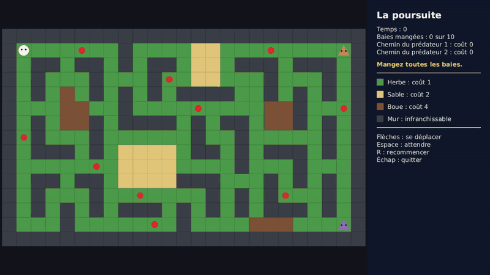

# Projet : Poursuite

Une proie et des prédateurs sur un terrain vu du dessus. Le joueur dirige la proie au clavier
et doit manger toutes les baies. Les prédateurs la poursuivent en suivant toujours le chemin
le plus rapide, calculé avec l'algorithme de Dijkstra. Le terrain compte : l'herbe se traverse
vite, le sable lentement, la boue très lentement.



La vidéo complète est disponible ici : [demo.mp4](assets/chase/demo.mp4).
Elle fait référence : votre application doit se comporter de la même façon.

**Barème :** ce projet compte pour **6 points sur 20**.

## Objectifs

Ce projet est un projet de **Java**, pas de JavaFX. À la fin, vous aurez pratiqué :

- la conception de plusieurs classes qui collaborent ;
- l'écriture d'un algorithme classique, le plus court chemin de Dijkstra, à l'intérieur d'une
  conception objet ;
- le choix des collections adaptées : file de priorité, tables associatives, ensembles ;
- les interfaces, pour isoler une stratégie du reste du programme ;
- les énumérations qui portent des données ;
- la gestion du clavier : une touche devient une action du modèle ;
- la séparation entre le **modèle** (la logique) et la **vue** (l'affichage).

Vous partez de zéro. Le sujet décrit ce que l'application doit faire et les règles à
respecter. Il ne donne ni la liste des classes ni les étapes à suivre : la conception et
l'organisation du travail vous reviennent. L'algorithme de Dijkstra n'est pas expliqué ici :
vous le trouverez dans n'importe quel cours d'algorithmique.

## Ce que fait l'application

### L'écran

- L'application s'ouvre en plein écran : le terrain à gauche, un panneau à droite.
- Le terrain est une grille de 25 colonnes sur 15 lignes. Les cases sont carrées. Leur taille
  est libre, mais le terrain entier doit être visible.
- Rien ne bouge tout seul : l'écran ne change que lorsque le joueur appuie sur une touche.

### Le terrain

Chaque case a un type de terrain. Entrer dans une case prend du temps : c'est son **coût**.

| Terrain | Coût pour y entrer |
|---|---|
| Herbe | 1 |
| Sable | 2 |
| Boue | 4 |
| Mur | infranchissable |

### Le niveau

Le jeu contient un seul niveau, toujours le même. Le voici, un caractère par case :

```
#########################
#P...o..#....::...o....X#
#.##.##.#.##.::.###.###.#
#.#...#...#o.::...#...#.#
#.#.~.#.#.#.####..#.#.#.#
#...~~..#....o....~~#..o#
#.#.~~#.####.#.##.~~#.#.#
#o#...#......#..#.....#.#
#.###.#.::::.##.#.###.#.#
#.....o.::::....#...#...#
#.##.##.::::###...#.#.#.#
#.#...#..o....#.#.#o..#.#
#.#.#.#.###.#.#.#.###.#.#
#...#.....o.#....~~~...X#
#########################
```

| Caractère | Signification |
|---|---|
| `#` | mur |
| `.` | herbe |
| `:` | sable |
| `~` | boue |
| `o` | une baie, posée sur de l'herbe |
| `P` | la proie, sur de l'herbe |
| `X` | un prédateur, sur de l'herbe |

### Les touches

| Touche | Action |
|---|---|
| Flèches | la proie tente d'aller sur la case voisine, dans la direction de la flèche |
| Espace | la proie attend une unité de temps |
| R | la partie recommence au début |
| Échap | l'application se ferme |

### La proie et le temps

Le temps se compte en unités. Il n'avance que lorsque la proie agit.

- Si la case visée est un mur, il ne se passe rien et le temps n'avance pas.
- Sinon, la proie entre dans la case. S'il y a une baie, elle la mange.
- Puis le temps avance du coût de la case : 1 unité pour l'herbe, 2 pour le sable, 4 pour la boue.
- Avec Espace, la proie reste sur place et le temps avance de 1 unité.

### Les prédateurs

À chaque unité de temps, chaque prédateur agit, l'un après l'autre :

1. Il calcule le **chemin le moins coûteux** de sa case à celle de la proie. Le coût d'un
   chemin est la somme des coûts des cases dans lesquelles on entre. Le chemin ne passe ni par
   un mur ni par la case d'un autre prédateur.
2. S'il est encore occupé à traverser sa case, il attend.
3. Sinon, il entre dans la première case du chemin. Entrer dans une case de coût *c* l'occupe
   pendant *c* unités de temps : il fera son pas suivant *c* unités de temps plus tard.

Un prédateur avance donc d'une case par unité de temps dans l'herbe, et reste 4 unités de temps
dans une case de boue. S'il existe plusieurs chemins de même coût, n'importe lequel convient.
S'il n'existe aucun chemin, le prédateur ne bouge pas.

Le chemin que chaque prédateur compte suivre est **dessiné sur le terrain**, dans la couleur
du prédateur.

### La fin de la partie

- Le joueur **perd** dès que la proie et un prédateur se trouvent sur la même case, que ce
  soit la proie ou le prédateur qui y entre.
- Le joueur **gagne** dès que la proie a mangé la dernière baie, sans se faire attraper sur
  cette case.

Une fois la partie terminée, les flèches et Espace ne font plus rien. Seules R et Échap répondent.

### Le panneau

Il affiche :

- le temps écoulé ;
- le nombre de baies mangées, sur le total ;
- pour chaque prédateur, le coût du chemin qui le sépare de la proie ;
- un message : la partie est en cours, gagnée ou perdue ;
- la légende : pour chaque terrain, sa couleur, son nom et son coût ;
- le rappel des touches.

## Règles à respecter

Ces règles font partie du sujet. Elles seront vérifiées.

1. **Deux paquetages : `model` et `view`.** Tout ce qui décide quelque chose (déplacements,
   temps, recherche de chemin, fin de partie) est dans `model`. Tout ce qui affiche est dans `view`.
2. **Aucun `import javafx` dans le paquetage `model`.** Le modèle doit pouvoir fonctionner
   sans fenêtre et sans clavier.
3. **Rien dans le modèle n'est une forme JavaFX.** Les classes du modèle n'héritent d'aucune
   classe JavaFX, n'en contiennent aucune et ne savent pas se dessiner. C'est la vue qui
   connaît le modèle, jamais l'inverse.
4. **Le modèle ne connaît pas la vue.** Aucune classe de `model` n'utilise une classe de `view`.
5. **Tous les attributs sont privés.** Aucun attribut `public`, aucune variable `static` modifiable.
6. **Vous écrivez l'algorithme de Dijkstra vous-mêmes**, avec les collections de Java.
   Aucune bibliothèque de graphes.
7. **La recherche de chemin est isolée.** Elle ne connaît ni la proie ni les prédateurs : on
   lui donne un terrain, un départ et une arrivée, elle rend un chemin. Un prédateur doit
   pouvoir recevoir une autre façon de choisir son chemin sans que sa classe soit modifiée.
8. **Pas de `instanceof`, et pas de `switch` ni de `if` sur le type d'un terrain** pour
   connaître son coût ou savoir s'il est franchissable. Chaque terrain porte ses données.
   Seule exception : la lecture du texte du niveau.
9. **La vue ne décide de rien.** Elle traduit une touche en un appel au modèle, puis
   redessine. Elle ne calcule aucun chemin : elle dessine celui que le modèle lui donne.
10. **Les nombres du sujet ne sont écrits qu'une fois.**
11. **La partie JavaFX reste petite** : environ 300 lignes au total dans `view`.

## Critères de validation

Votre travail est correct si :

- l'application se comporte comme décrit plus haut ;
- le chemin d'un prédateur est toujours de coût minimal : il contourne le sable ou la boue
  quand le détour coûte moins cher, et les traverse quand c'est le détour qui coûte plus cher ;
- le chemin est fait de cases voisines deux à deux, il part de la case du prédateur et arrive
  à celle de la proie ;
- la proie et les prédateurs ne se trouvent jamais sur un mur, et deux prédateurs ne se
  trouvent jamais sur la même case ;
- dans l'herbe, un prédateur avance d'une case par unité de temps ; après être entré dans la
  boue, il y reste 4 unités de temps ;
- une flèche vers un mur ne fait pas avancer le temps ;
- le niveau peut être gagné ;
- après la fin de la partie, plus rien ne change tant que le joueur n'appuie pas sur R ;
- toutes les règles ci-dessus sont respectées.

## Ce que vous rendez

- Le projet Maven complet, qui se lance avec `mvn javafx:run`.
- Un court fichier `README.md` qui liste vos classes, avec une phrase par classe pour
  expliquer son rôle, et qui justifie vos choix de conception.

## Pour aller plus loin

Ces extensions sont facultatives.

- **D'autres stratégies.** Un prédateur qui vise la case où la proie sera dans quelques pas,
  un prédateur qui prend le chemin le plus court en nombre de cases sans regarder le terrain,
  un prédateur qui se déplace au hasard. Chaque prédateur du niveau peut avoir la sienne.
- **L'algorithme A\*.** Il trouve le même chemin en explorant moins de cases. Affichez les
  cases explorées pour comparer.
- **Des terrains différents selon l'animal.** La proie nage : l'eau lui coûte 1, alors
  qu'elle est infranchissable pour les prédateurs.
- **Plusieurs niveaux**, lus dans des fichiers texte.
- **Une proie automatique.** La proie joue toute seule et cherche à gagner.
- **Du temps réel.** Les prédateurs avancent même quand le joueur ne fait rien.
