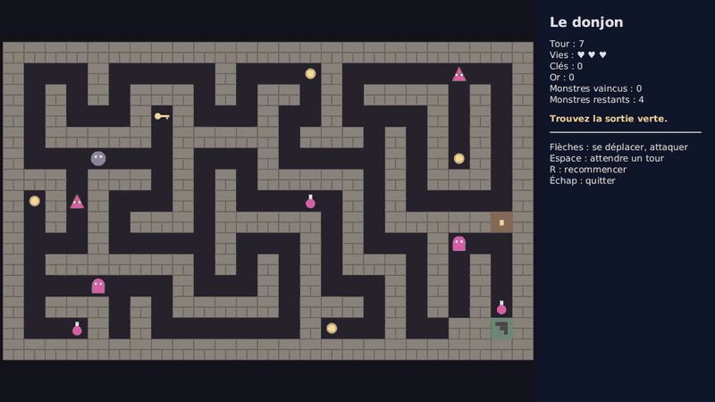

# Projet : Donjon

Un donjon vu du dessus. Le joueur dirige un héros au clavier, case par case : il ramasse une
clé, ouvre une porte, combat des monstres et cherche la sortie.



La vidéo complète est disponible ici : [dungeon_demo.mp4](assets/dungeon_demo.mp4).
Elle fait référence : votre application doit se comporter de la même façon.

**Barème :** ce projet compte pour **6 points sur 20**.

## Objectifs

Ce projet est un projet de **Java**, pas de JavaFX. À la fin, vous aurez pratiqué :

- la conception de nombreuses petites classes qui collaborent ;
- les interfaces, l'héritage et le polymorphisme : des objets différents qui répondent chacun
  à leur façon à la même question ;
- les objets qui changent d'état au cours de la partie ;
- l'encapsulation et les collections ;
- la gestion du clavier : une touche devient une action du modèle ;
- la séparation entre le **modèle** (la logique) et la **vue** (l'affichage).

Vous partez de zéro. Le sujet décrit ce que l'application doit faire et les règles à
respecter. Il ne donne ni la liste des classes ni les étapes à suivre : la conception et
l'organisation du travail vous reviennent.

## Ce que fait l'application

### L'écran

- L'application s'ouvre en plein écran : le donjon à gauche, un panneau à droite.
- Le donjon est une grille de 25 colonnes sur 15 lignes. Les cases sont carrées. Leur taille
  est libre, mais le donjon entier doit être visible.
- Rien ne bouge tout seul : l'écran ne change que lorsque le joueur appuie sur une touche.

### Le niveau

Le jeu contient un seul niveau, toujours le même. Le voici, un caractère par case :

```
#########################
#H..#.....#...G#....g...#
#.#.#.###.#.##.#.####.#.#
#.#...#K#...#..#....#.#.#
#.#####.#####.###.#.#.#.#
#...g...#...#.....#.#G#.#
###.###.#.#.#####.#.###.#
#G#.#...#.#...P.#.#.....#
#.#.#.###.#####.#.#####D#
#...#.....#...#.#...#..f#
#.#######.#.#.#.###.#.#.#
#.....f.#...#.#...#.#.#.#
#.###.#.#####.###.#.#.#P#
#..P#.#.......#G..#..##E#
#########################
```

| Caractère | Signification |
|---|---|
| `#` | mur |
| `.` | sol |
| `D` | porte verrouillée |
| `E` | sortie |
| `H` | le héros, sur du sol |
| `K` | une clé, posée sur du sol |
| `G` | de l'or, posé sur du sol |
| `P` | une potion, posée sur du sol |
| `g` | un gobelin, sur du sol |
| `f` | un fantôme, sur du sol |

### Les touches

| Touche | Action |
|---|---|
| Flèches | le héros tente d'aller sur la case voisine, dans la direction de la flèche |
| Espace | le héros attend |
| R | la partie recommence au début |
| Échap | l'application se ferme |

### Le tour

Le jeu se joue tour par tour. Chaque appui sur une flèche ou sur Espace joue un tour :

1. le héros agit ;
2. puis chaque monstre encore présent agit, l'un après l'autre.

Le tour est joué même si le héros n'a pas pu avancer.

### Le héros

Le héros commence avec 3 vies, sans clé et sans or. Quand il tente d'aller sur une case :

- **s'il y a un monstre**, le héros le frappe et reste à sa place. Le monstre perd 1 point de
  vie. À 0, il disparaît ;
- **si c'est un mur**, le héros reste à sa place ;
- **si c'est une porte verrouillée**, le héros reste à sa place s'il n'a pas de clé. S'il en a
  une, il la dépense, la porte s'ouvre pour toute la partie et le héros avance sur la case ;
- **si c'est du sol, une porte ouverte ou la sortie**, le héros avance sur la case.

Quand le héros arrive sur une case où un objet est posé, il le ramasse et l'objet disparaît :

| Objet | Effet |
|---|---|
| Clé | le héros a une clé de plus |
| Or | le héros gagne 10 pièces d'or |
| Potion | le héros regagne 1 vie, sans dépasser 3 |

### Les monstres

Un monstre ne se déplace que sur le sol : jamais sur un mur, une porte ou la sortie, et jamais
sur une case où se trouve un autre monstre. Il marche sur les objets sans les ramasser.

À son tour, un monstre choisit une case parmi ses quatre voisines où il peut aller. La case du
héros en fait partie si c'est du sol. Puis :

- si la case choisie est celle du héros, le monstre le frappe et reste à sa place : le héros
  perd 1 vie ;
- sinon, le monstre va sur la case choisie.

Si aucune case ne convient, le monstre ne fait rien. Les deux monstres ne choisissent pas leur
case de la même façon :

| Monstre | Points de vie | Choix de la case |
|---|---|---|
| Gobelin | 1 | une case au hasard parmi celles où il peut aller |
| Fantôme | 2 | la case la plus proche du héros, à condition qu'elle soit plus proche du héros que sa case actuelle |

La distance entre deux cases est le nombre de colonnes plus le nombre de lignes qui les
séparent. Si plusieurs cases conviennent au fantôme, il prend la première dans l'ordre haut,
droite, bas, gauche.

### La fin de la partie

- Le joueur **gagne** quand le héros arrive sur la sortie.
- Le joueur **perd** quand le héros n'a plus de vie.

Une fois la partie terminée, les flèches et Espace ne font plus rien. Seules R et Échap répondent.

### Le panneau

Il affiche :

- le numéro du tour ;
- les vies du héros, sur 3 ;
- son nombre de clés et son or ;
- le nombre de monstres vaincus et le nombre de monstres restants ;
- un message : la partie est en cours, gagnée ou perdue ;
- le rappel des touches.

## Règles à respecter

Ces règles font partie du sujet. Elles seront vérifiées.

1. **Deux paquetages : `model` et `view`.** Tout ce qui décide quelque chose (déplacements,
   combats, objets, fin de partie) est dans `model`. Tout ce qui affiche est dans `view`.
2. **Aucun `import javafx` dans le paquetage `model`.** Le modèle doit pouvoir fonctionner
   sans fenêtre et sans clavier.
3. **Rien dans le modèle n'est une forme JavaFX.** Les classes du modèle n'héritent d'aucune
   classe JavaFX, n'en contiennent aucune et ne savent pas se dessiner. C'est la vue qui
   connaît le modèle, jamais l'inverse.
4. **Le modèle ne connaît pas la vue.** Aucune classe de `model` n'utilise une classe de `view`.
5. **Tous les attributs sont privés.** Aucun attribut `public`, aucune variable `static` modifiable.
6. **Pas de `instanceof`, et pas de `switch` ni de `if` sur le type d'une case, d'un objet ou
   d'un monstre** pour décider de ce qui se passe. Le héros ne demande jamais à une case ce
   qu'elle est : chaque case, chaque objet et chaque monstre porte son propre comportement.
   Seule exception : la lecture du texte du niveau, qui crée le bon objet pour chaque caractère.
7. **La vue ne décide de rien.** Elle traduit une touche en un appel au modèle, puis redessine.
   Elle ne teste ni les murs, ni les clés, ni les vies.
8. **Les nombres du sujet ne sont écrits qu'une fois.** Ce sont des constantes nommées.
9. **La partie JavaFX reste petite** : environ 250 lignes au total dans `view`. Si elle
   grossit, c'est que de la logique s'est glissée dans la vue.

## Critères de validation

Votre travail est correct si :

- l'application se comporte comme décrit plus haut ;
- le niveau peut être terminé : la clé se ramasse, la porte s'ouvre, la sortie fait gagner ;
- le héros ne se trouve jamais sur un mur ni sur une porte verrouillée ;
- sans clé, la porte reste verrouillée ; avec une clé, elle s'ouvre, le héros a une clé de
  moins et la porte reste ouverte ;
- deux monstres ne se trouvent jamais sur la même case, et un monstre ne quitte jamais le sol ;
- les vies du héros restent entre 0 et 3 ;
- un gobelin disparaît au premier coup, un fantôme au deuxième ;
- après la fin de la partie, plus rien ne change tant que le joueur n'appuie pas sur R ;
- toutes les règles ci-dessus sont respectées.

## Ce que vous rendez

- Le projet Maven complet, qui se lance avec `mvn javafx:run`.
- Un court fichier `README.md` qui liste vos classes, avec une phrase par classe pour
  expliquer son rôle, et qui justifie vos choix de conception.

## Pour aller plus loin

Ces extensions sont facultatives.

- **Plusieurs niveaux.** La sortie mène au niveau suivant. Le héros garde ses vies et son or.
- **Des niveaux dans des fichiers.** Les niveaux sont lus dans des fichiers texte.
- **Un niveau au hasard.** Le labyrinthe est généré à chaque partie.
- **De nouveaux objets.** Une épée qui double les dégâts, un bouclier qui absorbe un coup, un
  parchemin qui montre le chemin vers la sortie.
- **De nouveaux monstres.** Un monstre qui traverse les murs, un monstre qui fuit le héros,
  un monstre qui ne bouge qu'un tour sur deux.
- **De nouvelles cases.** Un piège qui retire une vie, un téléporteur, de la glace sur
  laquelle le héros glisse jusqu'au prochain obstacle.
- **Le brouillard.** Seules les cases proches du héros sont visibles.
