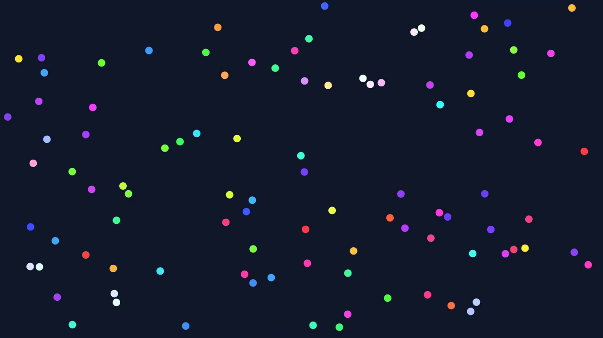

# Projet : Particules

Des particules colorées se déplacent en plein écran. Chacune part dans une direction
choisie au hasard, rebondit sur les bords de l'écran, et change de direction quand elle
en percute une autre.



Une vidéo d'une exécution est disponible ici : [demo.mp4](assets/particles/demo.mp4).
Elle fait référence : votre application doit se comporter de la même façon.

## Objectifs

Ce projet est un projet de **Java**, pas de JavaFX. À la fin, vous aurez pratiqué :

- la conception de plusieurs classes qui collaborent ;
- l'encapsulation (attributs privés, visibilité de paquetage, objets immuables) ;
- les collections et les streams ;
- les interfaces et les lambdas ;
- la séparation entre le **modèle** (la logique) et la **vue** (l'affichage).

Vous partez de zéro. Le sujet décrit ce que l'application doit faire et les règles à
respecter. Il ne donne ni la liste des classes ni les étapes à suivre : la conception et
l'organisation du travail vous reviennent.

## Ce que fait l'application

- L'application s'ouvre en plein écran, sur fond sombre, sans bouton ni panneau.
- Elle contient un nombre fixe de particules (150), créées au démarrage. Ce nombre ne change plus ensuite.
- Chaque particule est un disque de 8 pixels de rayon, d'une couleur tirée au hasard.
- Chaque particule démarre à un endroit libre (elle ne touche aucune autre particule), dans une
  direction tirée au hasard, à 150 pixels par seconde.
- Une particule rebondit sur les quatre bords de l'écran.
- Deux particules qui se touchent rebondissent l'une sur l'autre. La formule est donnée en
  [annexe B](#annexe-b--le-rebond-entre-deux-particules).
- La touche Espace met en pause et relance. La touche Échap quitte l'application.

## Règles à respecter

Ces règles font partie du sujet. Elles seront vérifiées.

1. **Deux paquetages : `model` et `view`.** Tout ce qui décide quelque chose (déplacement,
   rebonds, collisions, choix des couleurs) est dans `model`. Tout ce qui affiche est dans `view`.
2. **Aucun `import javafx` dans le paquetage `model`.** Le modèle doit pouvoir fonctionner
   sans fenêtre.
3. **Une particule n'est pas un cercle JavaFX.** La classe qui représente une particule
   n'hérite pas de `Circle`, ne contient pas de `Circle` et ne sait pas se dessiner.
   C'est la vue qui connaît le modèle, jamais l'inverse.
4. **Le modèle ne connaît pas la vue.** Aucune classe de `model` n'utilise une classe de `view`.
5. **Tous les attributs sont privés.** Aucun attribut `public`, aucune variable `static` modifiable.
6. **Les positions et les vitesses sont des vecteurs immuables.** Vous écrivez vous-même une
   classe de vecteur à deux dimensions : ses attributs sont `final` et chaque opération
   renvoie un nouveau vecteur. N'utilisez pas `Point2D` de JavaFX.
7. **Une particule ne peut pas être modifiée par n'importe qui.** Les méthodes qui changent
   sa position ou sa vitesse ne sont pas `public`. De même, la collection des particules ne
   doit pas pouvoir être modifiée depuis l'extérieur de la classe qui la possède.
8. **Pas de `instanceof`.**
9. **La partie JavaFX reste petite** : environ 150 lignes au total dans `view`. Si elle
   grossit, c'est que de la logique s'est glissée dans la vue.
10. **Un programme console.** En plus de l'application, vous fournissez un second `main` qui
    fait tourner la simulation sans ouvrir de fenêtre : il crée 100 particules, fait 1 000 pas
    de 1/60 de seconde, et affiche avant et après le nombre de particules, la vitesse moyenne
    et la somme des carrés des vitesses, calculées avec des **streams**.

## Critères de validation

Votre travail est correct si :

- l'application se comporte comme décrit plus haut ;
- après 1 000 pas, toutes les particules sont encore dans l'écran et leur nombre n'a pas changé ;
- deux particules lancées l'une vers l'autre sur la même ligne, avec les vitesses (100, 0) et
  (−40, 0), repartent avec les vitesses échangées : (−40, 0) et (100, 0) ;
- dans le programme console, le nombre de particules et la somme des carrés des vitesses sont
  identiques avant et après. Si la somme des carrés change, votre rebond est faux ;
- toutes les règles ci-dessus sont respectées.

## Ce que vous rendez

- Le projet Maven complet, qui se lance avec `mvn javafx:run`.
- Le programme console.
- Un court fichier `README.md` qui liste vos classes, avec une phrase par classe pour
  expliquer son rôle, et qui justifie vos choix de conception.

## Pour aller plus loin

Ces extensions sont facultatives.

- **Aller plus vite.** Comparer toutes les paires de particules devient lent avec plusieurs
  milliers de particules. Découpez le rectangle en cases et ne comparez que les particules
  de cases voisines. Rien ne doit changer dans `view`.
- **Plusieurs types de particules.** Une particule lourde (masse × 10), une particule fantôme
  qui traverse les autres, une particule collante qui absorbe celles qu'elle touche.
  Sans `instanceof` : c'est à chaque particule de dire comment elle se comporte.
- **Un compteur à l'écran.** Affichez le nombre de collisions depuis le démarrage, sans
  toucher au modèle.

## Annexe A : `pom.xml`

Remplacez la valeur de `mainClass` par le nom complet de votre classe d'application.

```xml
<?xml version="1.0" encoding="UTF-8"?>
<project xmlns="http://maven.apache.org/POM/4.0.0"
         xmlns:xsi="http://www.w3.org/2001/XMLSchema-instance"
         xsi:schemaLocation="http://maven.apache.org/POM/4.0.0 http://maven.apache.org/xsd/maven-4.0.0.xsd">
    <modelVersion>4.0.0</modelVersion>

    <groupId>fr.tp</groupId>
    <artifactId>particles</artifactId>
    <version>1.0</version>

    <properties>
        <maven.compiler.release>17</maven.compiler.release>
        <project.build.sourceEncoding>UTF-8</project.build.sourceEncoding>
        <javafx.version>21.0.5</javafx.version>
    </properties>

    <dependencies>
        <dependency>
            <groupId>org.openjfx</groupId>
            <artifactId>javafx-controls</artifactId>
            <version>${javafx.version}</version>
        </dependency>
    </dependencies>

    <build>
        <plugins>
            <plugin>
                <groupId>org.apache.maven.plugins</groupId>
                <artifactId>maven-compiler-plugin</artifactId>
                <version>3.13.0</version>
            </plugin>
            <plugin>
                <groupId>org.openjfx</groupId>
                <artifactId>javafx-maven-plugin</artifactId>
                <version>0.0.8</version>
                <configuration>
                    <!-- the full name of your application class -->
                    <mainClass>fr.tp.particles.view.YourApplicationClass</mainClass>
                </configuration>
            </plugin>
        </plugins>
    </build>
</project>
```

Il faut un JDK 17 ou plus récent. Maven télécharge JavaFX tout seul.

| Pour… | Commande |
|---|---|
| compiler | `mvn compile` |
| lancer l'application | `mvn javafx:run` |
| lancer le programme console | `mvn compile` puis `java -cp target/classes` suivi du nom complet de sa classe |

Pour lancer l'application depuis l'IDE avec le bouton « Run », écrivez une petite classe à
part dont le `main` appelle simplement le `main` de votre classe d'application. Lancer
directement une classe qui hérite de `Application` provoque l'erreur
« JavaFX runtime components are missing ».

## Annexe B : le rebond entre deux particules

Toutes les particules ont la même masse. Soient deux particules A et B qui se touchent
(la distance entre leurs centres est inférieure à deux rayons), de positions `pA` et `pB`,
de vitesses `vA` et `vB`, et de rayon `R`.

1. **La direction du choc.** `d` est la distance entre les centres, et `n` le vecteur de
   longueur 1 qui va de A vers B :

   `n = (pB − pA) / d`

2. **La vitesse d'approche** le long de cette direction (un produit scalaire) :

   `s = (vA − vB) · n`

3. **Si `s > 0`**, les particules se rapprochent : elles échangent cette part de leur vitesse.

   `vA ← vA − s × n`

   `vB ← vB + s × n`

   Si `s ≤ 0`, elles s'éloignent déjà : on ne touche pas aux vitesses.

4. **Séparer les particules.** Elles se chevauchent de `2R − d`. On recule chacune de la
   moitié de ce chevauchement, pour qu'elles ne restent pas collées :

   `pA ← pA − n × (2R − d) / 2`

   `pB ← pB + n × (2R − d) / 2`

Cas particulier : si `d` vaut 0 (les deux centres sont confondus), prenez `n = (1, 0)`.

Ce rebond conserve la somme des carrés des vitesses. C'est ce que vérifie le programme console.

## Annexe C : aide-mémoire JavaFX

Vous n'avez besoin de rien d'autre que ce qui suit.

| Besoin | Appel JavaFX |
|---|---|
| Point d'entrée de l'application | une classe qui hérite de `Application` et redéfinit `start(Stage stage)` |
| Taille de l'écran | `Screen.getPrimary().getBounds()` |
| Un panneau où placer librement des formes | `Pane`, et `pane.getChildren().add(node)` |
| Couleur de fond du panneau | `pane.setStyle("-fx-background-color: #0f172a;")` |
| Un disque centré sur (0, 0) | `new Circle(radius)` |
| Déplacer une forme | `node.setTranslateX(x)` et `node.setTranslateY(y)` |
| Couleur à partir d'une teinte | `Color.hsb(hue, 0.75, 1.0)` |
| Colorer un disque | `circle.setFill(color)` |
| Afficher la fenêtre | `stage.setScene(new Scene(pane))` puis `stage.show()` |
| Plein écran | `stage.setFullScreen(true)`, et `stage.setFullScreenExitHint("")` pour masquer le message |
| Clavier | `scene.setOnKeyPressed(event -> ...)` et `event.getCode() == KeyCode.SPACE` |
| Quitter | `Platform.exit()` |
| Exécuter du code à chaque image | une classe anonyme qui hérite de `AnimationTimer`, redéfinit `handle(long now)`, puis `start()` |

Dans `handle(long now)`, `now` est l'heure en nanosecondes. Le temps écoulé depuis l'image
précédente, en secondes, est `(now - previous) / 1e9`. Limitez-le à 0,05 seconde pour éviter
un saut après une pause.

Placez les cercles dans un `Pane` simple. Un `StackPane` ou une `VBox` repositionne ses
enfants et écrase vos coordonnées.
