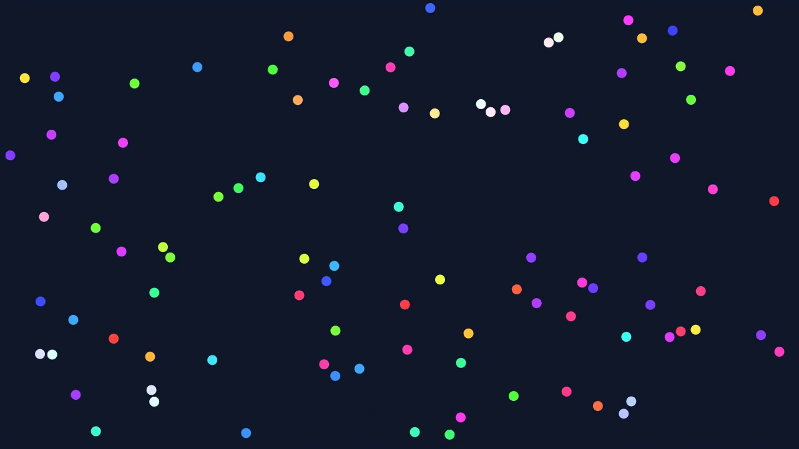

# Projet : Particules

Des particules colorées se déplacent en plein écran. Chacune part dans une direction
choisie au hasard, rebondit sur les bords de l'écran, et change de direction quand elle
en percute une autre.



Une vidéo d'une exécution est disponible ici : [demo.mp4](demo.mp4).

## Objectifs

Ce projet est un projet de **Java**, pas de JavaFX. À la fin, vous aurez pratiqué :

- la conception de plusieurs classes qui collaborent ;
- l'encapsulation (attributs privés, visibilité de paquetage, objets immuables) ;
- les collections et les streams ;
- les interfaces, les lambdas et le patron Observateur ;
- la séparation entre le **modèle** (la logique) et la **vue** (l'affichage).

JavaFX n'intervient qu'à la fin, pour dessiner ce que le modèle a calculé.

## Ce que fait l'application

- L'application s'ouvre en plein écran, sur fond sombre, sans bouton ni panneau.
- Elle contient un nombre fixe de particules (150), créées au démarrage. Ce nombre ne change plus ensuite.
- Chaque particule est un disque de 8 pixels de rayon, d'une couleur tirée au hasard.
- Chaque particule démarre à un endroit libre, dans une direction tirée au hasard, à 150 pixels par seconde.
- Une particule rebondit sur les quatre bords de l'écran.
- Deux particules qui se touchent rebondissent l'une sur l'autre.
- Une particule devient blanche un court instant quand elle vient de percuter une autre particule.
- La touche Espace met en pause et relance. La touche Échap quitte l'application.

## Règles à respecter

Ces règles font partie du sujet. Elles seront vérifiées.

1. **Aucun `import javafx` dans le paquetage `model`.** Le modèle doit pouvoir fonctionner sans fenêtre.
2. **`Particle` n'est pas un `Circle`.** Elle n'hérite pas de `Circle`, ne contient pas de `Circle` et n'a pas de méthode `draw`. C'est la vue qui connaît le modèle, jamais l'inverse.
3. **Tous les attributs sont privés.** Aucun attribut `public`, aucune variable `static` modifiable.
4. **`Vector2` est immuable.** Ses attributs sont `final` et aucune méthode ne le modifie : chaque opération renvoie un nouveau vecteur.
5. **Seul `World` peut modifier une particule de l'extérieur.** Les méthodes qui changent la position ou la vitesse d'une particule ne sont pas `public`.
6. **Pas de `instanceof`.**
7. **La partie JavaFX reste petite** : trois classes, environ 150 lignes au total. Si elle grossit, c'est que de la logique s'est glissée dans la vue.
8. **Le code est en anglais** : noms de classes, de méthodes, de variables et commentaires.

## Architecture attendue

Vous écrivez tout vous-même. Voici les classes attendues et leur rôle. Les noms des
méthodes sont donnés à titre indicatif.

```
fr.tp.particles
├── Launcher               lance l'application depuis l'IDE
├── ConsoleMain            fait tourner la simulation sans fenêtre
├── model                  aucun import javafx ici
│   ├── Vector2            vecteur 2D immuable
│   ├── Particle           position, vitesse, couleur ; se déplace, rebondit sur les bords
│   ├── World              la liste des particules et la règle de collision
│   └── CollisionListener  interface : « deux particules viennent de se percuter »
└── view
    ├── ParticlesApp       la fenêtre plein écran, la boucle d'animation, le clavier
    ├── WorldView          le panneau qui contient un cercle par particule
    └── ParticleView       le lien entre une Particle et son Circle
```

| Classe | Rôle |
|---|---|
| `Vector2` | Un couple (x, y) immuable avec les opérations `plus`, `minus`, `times`, `dot`, `length`, `distanceTo`. Il sert pour les positions et pour les vitesses. |
| `Particle` | Possède une position, une vitesse et une teinte. Sait avancer (`move`), rebondir sur les bords (`bounceOffWalls`) et dire si elle en touche une autre (`overlaps`). |
| `World` | Crée les particules, les fait avancer d'un pas de temps (`step`), détecte et traite les collisions, prévient ses observateurs. |
| `CollisionListener` | Interface à une seule méthode, appelée par `World` à chaque collision. |
| `ParticleView` | Crée le `Circle` d'une particule et recopie l'état de la particule vers le cercle. |
| `WorldView` | Contient les cercles. Observe le monde pour déclencher l'éclair blanc. |
| `ParticlesApp` | Ouvre la fenêtre, appelle `world.step(...)` puis `view.refresh(...)` à chaque image. |

### La direction est dans la vitesse

Une particule n'a pas d'attribut « direction ». Sa vitesse est un vecteur : la direction
dans laquelle il pointe est la direction de la particule, et sa longueur est sa vitesse en
pixels par seconde. Pour créer une vitesse dans une direction au hasard :

```java
double angle = random.nextDouble() * 2 * Math.PI;
Vector2 velocity = new Vector2(Math.cos(angle) * speed, Math.sin(angle) * speed);
```

Changer de direction revient donc à remplacer le vecteur vitesse.

### La couleur est dans le modèle, sans JavaFX

La particule possède sa couleur, mais le modèle n'a pas le droit d'importer
`javafx.scene.paint.Color`. La couleur est donc stockée sous la forme d'une **teinte** :
un nombre entre 0 et 360, sa position sur le cercle chromatique. C'est la vue qui
transforme cette teinte en couleur JavaFX.

## Étapes

Faites les étapes dans l'ordre. Chaque étape se termine par un **point de contrôle** :
ne passez pas à la suivante tant qu'il n'est pas validé.

Les étapes 1 à 5 sont du Java pur. Vous n'ouvrez aucune fenêtre avant l'étape 6.

### Étape 0 : le projet

Créez un projet Maven avec le `pom.xml` donné en [annexe A](#annexe-a--pomxml), et les
paquetages `fr.tp.particles`, `fr.tp.particles.model` et `fr.tp.particles.view`.

**Point de contrôle :** `mvn compile` se termine sans erreur.

### Étape 1 : `Vector2`

Écrivez la classe immuable `Vector2`, avec les opérations listées plus haut.
Ajoutez `equals`, `hashCode` et `toString`.

**Point de contrôle :** dans un `main` provisoire, `new Vector2(3, 4).length()` vaut `5.0`,
et `a.plus(b)` ne modifie ni `a` ni `b`.

### Étape 2 : `Particle`

Une particule a une position, une vitesse et une teinte. Écrivez :

- `move(double dt)` : la particule avance pendant `dt` secondes (position + vitesse × dt) ;
- `bounceOffWalls(double width, double height)` : si la particule dépasse d'un bord, elle
  est replacée contre ce bord et la composante correspondante de sa vitesse change de signe ;
- `overlaps(Particle other)` : vrai si la distance entre les deux centres est inférieure à deux rayons.

**Point de contrôle :** une particule placée en (10, 10) avec une vitesse (−100, 0) dans un
monde de 400 × 300 repart vers la droite après quelques appels à `move` puis `bounceOffWalls`.

### Étape 3 : `World`, sans les collisions

Le monde reçoit sa largeur, sa hauteur et le nombre de particules dans son constructeur.
Il crée les particules à des endroits tirés au hasard, de sorte qu'aucune n'en touche une autre
au départ. La méthode `step(double dt)` fait avancer toutes les particules et les fait
rebondir sur les bords.

La liste des particules est accessible en lecture, mais elle ne doit pas pouvoir être
modifiée depuis l'extérieur.

**Point de contrôle :** après 1 000 appels à `step(1.0 / 60)`, toutes les particules sont
encore à l'intérieur du monde et leur nombre n'a pas changé.

### Étape 4 : les collisions

À chaque pas, le monde examine chaque paire de particules. Si deux particules se touchent,
elles rebondissent l'une sur l'autre. La formule est donnée en
[annexe B](#annexe-b--le-rebond-entre-deux-particules) : vous n'avez pas à l'inventer,
seulement à l'écrire proprement avec `Vector2`.

**Point de contrôle :** deux particules lancées l'une vers l'autre sur la même ligne,
à (100, 0) et (−40, 0), repartent avec les vitesses échangées : (−40, 0) et (100, 0).

### Étape 5 : `CollisionListener` et `ConsoleMain`

Écrivez l'interface `CollisionListener`. Le monde garde une liste d'observateurs et les
prévient à chaque collision.

Écrivez ensuite `ConsoleMain`, un programme sans fenêtre qui :

- crée un monde de 100 particules ;
- s'abonne aux collisions avec une **lambda** pour les compter ;
- fait 1 000 pas de simulation ;
- affiche, avant et après, le nombre de particules, la vitesse moyenne et la somme des
  carrés des vitesses, calculées avec des **streams**.

**Point de contrôle :** le nombre de particules et la somme des carrés des vitesses sont
identiques avant et après. Le nombre de collisions est de plusieurs centaines.
Si la somme des carrés change, votre rebond est faux.

Exemple de sortie (les valeurs exactes varient d'une exécution à l'autre) :

```
Before: 100 particles, average speed 150.0 px/s, energy 2250000
After 1000 steps: 100 particles, average speed 136.8 px/s, energy 2250000
Collisions: 557
```

### Étape 6 : l'affichage

C'est seulement maintenant que JavaFX entre en jeu. Les appels utiles sont listés en
[annexe C](#annexe-c--aide-mémoire-javafx).

- `ParticleView` reçoit une `Particle`, crée son `Circle` avec la bonne couleur, et possède
  une méthode `refresh` qui recopie la position de la particule vers le cercle.
- `WorldView` est un `Pane` qui garde une `ParticleView` par particule.
- `ParticlesApp` crée un monde de la taille de l'écran, passe en plein écran, et à chaque
  image appelle `world.step(...)` puis `view.refresh(...)`.
- Espace met en pause, Échap quitte.

**Point de contrôle :** l'application ressemble à la vidéo. `ConsoleMain` fonctionne
toujours, et le paquetage `model` ne contient toujours aucun `import javafx`.

### Étape 7 : l'éclair blanc

`WorldView` implémente `CollisionListener` et s'abonne au monde. Quand deux particules se
percutent, leurs cercles deviennent blancs puis reprennent leur couleur en un tiers de seconde.

Remarquez que vous n'avez rien changé dans `World` : il prévenait déjà ses observateurs.

**Point de contrôle :** les particules qui viennent de se percuter clignotent en blanc.

## Pour aller plus loin

Ces extensions sont facultatives.

- **Une grille pour aller plus vite.** Comparer toutes les paires devient lent avec plusieurs
  milliers de particules. Découpez le monde en cases et ne comparez que les particules de
  cases voisines. Seul `World` doit changer.
- **Plusieurs types de particules.** Une particule lourde (masse × 10), une particule fantôme
  qui traverse les autres, une particule collante qui absorbe celles qu'elle touche.
  Sans `instanceof` : c'est à chaque particule de dire comment elle se comporte.
- **Un compteur à l'écran.** Affichez le nombre de collisions depuis le démarrage, sans
  toucher au modèle.

## Annexe A : `pom.xml`

```xml
<?xml version="1.0" encoding="UTF-8"?>
<project xmlns="http://maven.apache.org/POM/4.0.0"
         xmlns:xsi="http://www.w3.org/2001/XMLSchema-instance"
         xsi:schemaLocation="http://maven.apache.org/POM/4.0.0 http://maven.apache.org/xsd/maven-4.0.0.xsd">
    <modelVersion>4.0.0</modelVersion>

    <groupId>fr.tp</groupId>
    <artifactId>particles</artifactId>
    <version>1.0</version>

    <properties>
        <maven.compiler.release>17</maven.compiler.release>
        <project.build.sourceEncoding>UTF-8</project.build.sourceEncoding>
        <javafx.version>21.0.5</javafx.version>
    </properties>

    <dependencies>
        <dependency>
            <groupId>org.openjfx</groupId>
            <artifactId>javafx-controls</artifactId>
            <version>${javafx.version}</version>
        </dependency>
    </dependencies>

    <build>
        <plugins>
            <plugin>
                <groupId>org.apache.maven.plugins</groupId>
                <artifactId>maven-compiler-plugin</artifactId>
                <version>3.13.0</version>
            </plugin>
            <plugin>
                <groupId>org.openjfx</groupId>
                <artifactId>javafx-maven-plugin</artifactId>
                <version>0.0.8</version>
                <configuration>
                    <mainClass>fr.tp.particles.view.ParticlesApp</mainClass>
                </configuration>
            </plugin>
        </plugins>
    </build>
</project>
```

Il faut un JDK 17 ou plus récent. Maven télécharge JavaFX tout seul.

| Pour… | Commande |
|---|---|
| compiler | `mvn compile` |
| lancer l'application | `mvn javafx:run` |
| lancer `ConsoleMain` | `mvn compile` puis `java -cp target/classes fr.tp.particles.ConsoleMain` |

Pour lancer l'application depuis l'IDE avec le bouton « Run », écrivez une classe `Launcher`
dont le `main` appelle simplement `ParticlesApp.main(args)`. Lancer directement une classe
qui hérite de `Application` provoque l'erreur « JavaFX runtime components are missing ».

## Annexe B : le rebond entre deux particules

Toutes les particules ont la même masse. Soient deux particules A et B qui se touchent,
de positions `pA` et `pB`, de vitesses `vA` et `vB`, et de rayon `R`.

1. **La direction du choc.** `d` est la distance entre les centres, et `n` le vecteur de
   longueur 1 qui va de A vers B :

   `n = (pB − pA) / d`

2. **La vitesse d'approche** le long de cette direction (un produit scalaire) :

   `s = (vA − vB) · n`

3. **Si `s > 0`**, les particules se rapprochent : elles échangent cette part de leur vitesse.

   `vA ← vA − s × n`

   `vB ← vB + s × n`

   Si `s ≤ 0`, elles s'éloignent déjà : on ne touche pas aux vitesses. C'est dans le cas
   `s > 0` qu'il y a réellement une collision à signaler aux observateurs.

4. **Séparer les particules.** Elles se chevauchent de `2R − d`. On recule chacune de la
   moitié de ce chevauchement, pour qu'elles ne restent pas collées :

   `pA ← pA − n × (2R − d) / 2`

   `pB ← pB + n × (2R − d) / 2`

Cas particulier : si `d` vaut 0 (les deux centres sont confondus), prenez `n = (1, 0)`.

Ce rebond conserve la somme des carrés des vitesses. C'est ce que vérifie `ConsoleMain`.

## Annexe C : aide-mémoire JavaFX

Vous n'avez besoin de rien d'autre que ce qui suit.

| Besoin | Appel JavaFX |
|---|---|
| Point d'entrée de l'application | une classe qui hérite de `Application` et redéfinit `start(Stage stage)` |
| Taille de l'écran | `Screen.getPrimary().getBounds()` |
| Un panneau où placer librement des formes | `Pane`, et `pane.getChildren().add(node)` |
| Couleur de fond du panneau | `pane.setStyle("-fx-background-color: #0f172a;")` |
| Un disque centré sur (0, 0) | `new Circle(radius)` |
| Déplacer une forme | `node.setTranslateX(x)` et `node.setTranslateY(y)` |
| Couleur à partir d'une teinte | `Color.hsb(hue, 0.75, 1.0)` |
| Colorer un disque | `circle.setFill(color)` |
| Mélanger deux couleurs | `color.interpolate(Color.WHITE, t)` avec `t` entre 0 et 1 |
| Afficher la fenêtre | `stage.setScene(new Scene(pane))` puis `stage.show()` |
| Plein écran | `stage.setFullScreen(true)`, et `stage.setFullScreenExitHint("")` pour masquer le message |
| Clavier | `scene.setOnKeyPressed(event -> ...)` et `event.getCode() == KeyCode.SPACE` |
| Quitter | `Platform.exit()` |
| Exécuter du code à chaque image | une classe anonyme qui hérite de `AnimationTimer`, redéfinit `handle(long now)`, puis `start()` |

Dans `handle(long now)`, `now` est l'heure en nanosecondes. Le temps écoulé depuis l'image
précédente, en secondes, est `(now - previous) / 1e9`. Limitez-le à 0,05 seconde pour éviter
un saut après une pause.

Placez les cercles dans un `Pane` simple. Un `StackPane` ou une `VBox` repositionne ses
enfants et écrase vos coordonnées.
