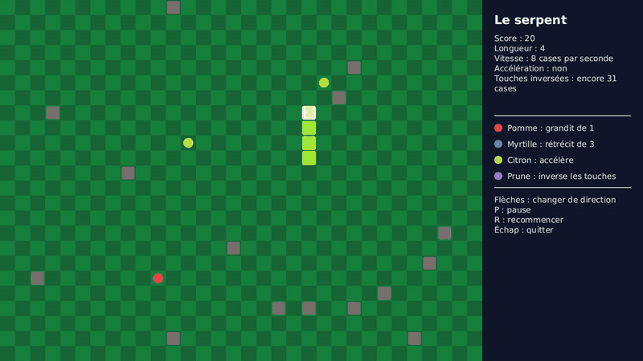

# Projet : Serpent

Le jeu du serpent, avec une différence : il existe quatre aliments, et chacun a un effet
différent. L'un fait grandir, un autre fait rétrécir, un autre accélère, le dernier inverse
les touches.

La vidéo complète est disponible ici : [snake_demo.mp4](assets/snake_demo.mp4).
Elle fait référence : votre application doit se comporter de la même façon.

**Barème :** ce projet compte pour **6 points sur 20**.

## Objectifs

Ce projet est un projet de **Java**, pas de JavaFX. À la fin, vous aurez pratiqué :

- la conception de plusieurs classes qui collaborent ;
- les classes abstraites et le polymorphisme : des aliments différents qui agissent chacun à
  leur façon ;
- le choix d'une collection adaptée pour représenter le corps du serpent ;
- les objets qui changent d'état au cours du temps ;
- la gestion du clavier : une touche devient une demande faite au modèle ;
- la séparation entre le **modèle** (la logique) et la **vue** (l'affichage).

Vous partez de zéro. Le sujet décrit ce que l'application doit faire et les règles à
respecter. Il ne donne ni la liste des classes ni les étapes à suivre : la conception et
l'organisation du travail vous reviennent.

## Ce que fait l'application

### L'écran

- L'application s'ouvre en plein écran : le terrain à gauche, un panneau à droite.
- Le terrain est une grille de cases carrées de 30 pixels de côté. Il occupe toute la place
  laissée par le panneau.

### Les touches

| Touche | Action |
|---|---|
| Flèches | demander au serpent de changer de direction |
| P | mettre en pause, puis relancer |
| R | commencer une nouvelle partie |
| Échap | fermer l'application |

### Le début de la partie

- Le serpent mesure 4 cases. Sa tête est sur la case du milieu du terrain, son corps s'étend
  vers la gauche, et il se dirige vers la droite.
- 15 obstacles sont placés au hasard, chacun sur une case. Aucun n'est sur la ligne du serpent.
- 3 aliments sont placés au hasard sur des cases libres.
- Le score vaut 0.

### Le déplacement

- Le serpent avance tout seul, d'une case à la fois, à 8 cases par seconde.
- À chaque déplacement, la tête entre dans la case suivante et la queue quitte la sienne.
- Une flèche ne déplace pas le serpent : elle fixe la direction de son prochain déplacement.
  Si le joueur appuie sur plusieurs flèches entre deux déplacements, la dernière demande
  acceptée l'emporte.
- Le serpent ne peut pas faire demi-tour : une demande opposée à la direction de son dernier
  déplacement est ignorée.

### La fin de la partie

La partie est terminée si, en avançant, la tête :

- sort du terrain ;
- entre dans la case d'un obstacle ;
- entre dans une case occupée par le corps du serpent. La case de la queue ne compte pas si
  la queue la quitte pendant ce déplacement.

Le serpent s'arrête alors et ne bouge plus. Seules R et Échap répondent.

### Les aliments

Il y a toujours exactement 3 aliments sur le terrain. Quand la tête entre dans la case d'un
aliment, le serpent le mange : le score augmente, l'effet s'applique, et un nouvel aliment
apparaît aussitôt sur une case libre choisie au hasard. Une case libre ne contient ni serpent,
ni obstacle, ni aliment. Le type du nouvel aliment est tiré au hasard :

| Aliment | Couleur | Fréquence | Points | Effet |
|---|---|---|---|---|
| Pomme | rouge | 55 % | 10 | le serpent grandit de 1 case |
| Myrtille | bleu | 15 % | 5 | le serpent perd 3 cases, sans descendre sous 2 cases |
| Citron | jaune | 15 % | 15 | le serpent accélère pendant ses 40 prochains déplacements |
| Prune | violet | 15 % | 20 | les touches sont inversées pendant ses 40 prochains déplacements |

Précisions :

- **Grandir.** Au déplacement suivant, la queue reste à sa place au lieu de quitter sa case.
- **Rétrécir.** Les cases sont retirées tout de suite, du côté de la queue.
- **Accélérer.** Le serpent avance 1,5 fois plus vite : 12 cases par seconde.
- **Touches inversées.** La flèche gauche demande d'aller à droite, la flèche haut demande
  d'aller en bas, et inversement.
- Manger un citron ou une prune alors que son effet est déjà en cours remet le compte à 40.
  Les deux effets peuvent être en cours en même temps.

### Le panneau

Il affiche :

- le score ;
- la longueur du serpent ;
- sa vitesse actuelle ;
- pour chacun des deux effets, le nombre de déplacements restants ;
- la légende : pour chaque aliment, sa couleur, son nom et son effet ;
- un message quand la partie est terminée ;
- le rappel des touches.

## Règles à respecter

Ces règles font partie du sujet. Elles seront vérifiées.

1. **Deux paquetages : `model` et `view`.** Tout ce qui décide quelque chose (déplacement,
   collisions, aliments, effets, score, vitesse) est dans `model`. Tout ce qui affiche est
   dans `view`.
2. **Aucun `import javafx` dans le paquetage `model`.** Le modèle doit pouvoir fonctionner
   sans fenêtre et sans clavier.
3. **Rien dans le modèle n'est une forme JavaFX.** Les classes du modèle n'héritent d'aucune
   classe JavaFX, n'en contiennent aucune et ne savent pas se dessiner. C'est la vue qui
   connaît le modèle, jamais l'inverse.
4. **Le modèle ne connaît pas la vue.** Aucune classe de `model` n'utilise une classe de `view`.
5. **Tous les attributs sont privés.** Aucun attribut `public`, aucune variable `static` modifiable.
6. **Pas de `instanceof`, et pas de `switch` ni de `if` sur le type d'un aliment** pour
   décider de son effet, de ses points ou de sa fréquence. Chaque aliment porte ses nombres et
   son comportement.
7. **La vue ne décide de rien.** Elle transmet la flèche au modèle telle quelle, lui demande à
   quelle vitesse avancer, et dessine. L'inversion des touches, le refus du demi-tour et
   l'accélération sont l'affaire du modèle.
8. **Les nombres du sujet ne sont écrits qu'une fois.** Ce sont des constantes nommées, ou
   les données d'une énumération.
9. **La partie JavaFX reste petite** : environ 250 lignes au total dans `view`. Si elle
   grossit, c'est que de la logique s'est glissée dans la vue.

## Critères de validation

Votre travail est correct si :

- l'application se comporte comme décrit plus haut ;
- le serpent n'occupe jamais deux fois la même case, ni une case d'obstacle, ni une case hors
  du terrain ;
- il y a toujours exactement 3 aliments, chacun sur une case libre ;
- une demande de demi-tour ne change rien ;
- pendant l'inversion, la flèche gauche fait aller le serpent à droite ;
- après une pomme, la longueur augmente de 1 au déplacement suivant ; après une myrtille,
  elle diminue de 3 sans descendre sous 2 ;
- la vitesse vaut 12 cases par seconde pendant exactement 40 déplacements après un citron,
  puis revient à 8 ;
- sur un grand nombre de tirages, les aliments apparaissent selon les fréquences du tableau ;
- après la fin de la partie, plus rien ne change tant que le joueur n'appuie pas sur R ;
- toutes les règles ci-dessus sont respectées.

## Ce que vous rendez

- Le projet Maven complet, qui se lance avec `mvn javafx:run`.
- Un court fichier `README.md` qui liste vos classes, avec une phrase par classe pour
  expliquer son rôle, et qui justifie vos choix de conception.

## Pour aller plus loin

Ces extensions sont facultatives.

- **De nouveaux aliments.** Un aliment qui rend le serpent invincible quelques secondes, un
  aliment qui supprime un obstacle, un aliment qui disparaît s'il n'est pas mangé à temps.
- **Des bords ouverts.** Le serpent qui sort d'un côté réapparaît de l'autre.
- **Des niveaux.** Tous les 100 points, de nouveaux obstacles apparaissent.
- **Le meilleur score.** Il est conservé d'une partie à l'autre, puis d'un lancement à l'autre.
- **Deux joueurs.** Un second serpent, dirigé avec les touches Z, Q, S et D.
- **Un serpent adverse.** Un second serpent qui joue tout seul.
