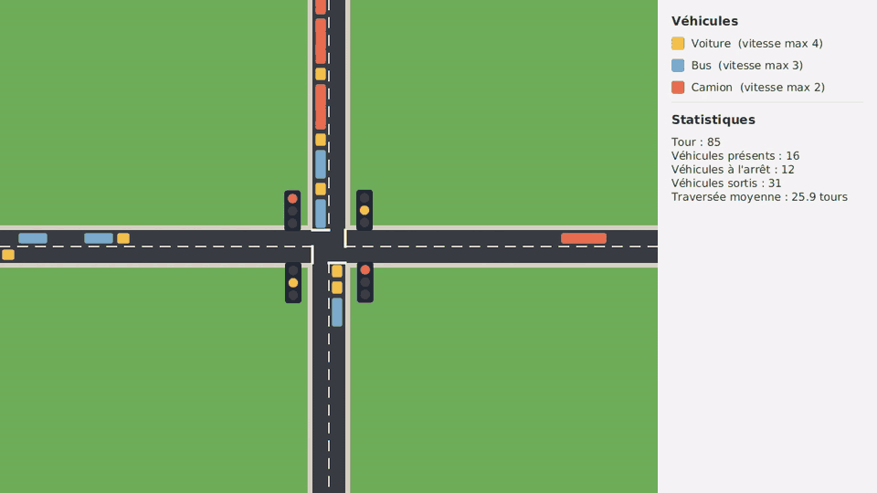

# Projet : Carrefour

Un carrefour vu du dessus : deux routes se croisent, des feux règlent la circulation.
Des voitures, des bus et des camions arrivent des quatre côtés, font la queue au feu rouge,
puis traversent quand le feu passe au vert.

La vidéo complète est disponible ici : [demo.mp4](assets/traffic/demo.mp4).
Elle fait référence : votre application doit se comporter de la même façon.

**Barème :** ce projet compte pour **6 points sur 20**.

## Objectifs

Ce projet est un projet de **Java**, pas de JavaFX. À la fin, vous aurez pratiqué :

- la conception de plusieurs classes qui collaborent ;
- la composition : des objets qui en contiennent d'autres ;
- les objets qui changent d'état au cours du temps ;
- les énumérations qui portent des données et du comportement ;
- l'encapsulation, les collections et les streams ;
- la séparation entre le **modèle** (la logique) et la **vue** (l'affichage).

Vous partez de zéro. Le sujet décrit ce que l'application doit faire et les règles à
respecter. Il ne donne ni la liste des classes ni les étapes à suivre : la conception et
l'organisation du travail vous reviennent.

## Ce que fait l'application

### Le carrefour

- L'application s'ouvre en plein écran : le carrefour à gauche, un panneau à droite.
- Le carrefour est posé sur une grille de cases carrées de 24 pixels de côté.
- Une route horizontale et une route verticale se croisent au milieu. Chacune traverse toute la grille.
- Chaque route a deux voies, une par sens. Une voie est une rangée de cases, large d'une case.
  Le croisement est donc un carré de 2 cases sur 2.
- On roule à droite. Tous les véhicules vont tout droit : personne ne tourne.
- Sur chaque voie, la dernière case avant le croisement est la **case d'arrêt**. Un feu se trouve à côté.
- La touche Espace met en pause et relance. La touche Échap quitte l'application.

### Le temps

- Le temps avance par tours. L'application joue 3 tours par seconde.
- À chaque tour, dans cet ordre : les feux avancent, puis, voie par voie, les véhicules
  jouent du premier au dernier, puis un nouveau véhicule arrive peut-être sur la voie.

### Les feux

Les deux feux d'une même route montrent toujours la même couleur. Le carrefour enchaîne
six phases, toujours dans cet ordre, puis recommence :

| Phase | Durée | Route horizontale | Route verticale |
|---|---|---|---|
| 1 | 24 tours | vert | rouge |
| 2 | 3 tours | orange | rouge |
| 3 | 3 tours | rouge | rouge |
| 4 | 24 tours | rouge | vert |
| 5 | 3 tours | rouge | orange |
| 6 | 3 tours | rouge | rouge |

### Les véhicules

Il existe trois types de véhicules. Chacun est dessiné comme un rectangle de sa couleur.
Un véhicule long occupe plusieurs cases à la suite sur sa voie.

| Type | Longueur | Vitesse maximale | Part des arrivées |
|---|---|---|---|
| Voiture | 1 case | 4 cases par tour | 70 % |
| Bus | 2 cases | 3 cases par tour | 15 % |
| Camion | 3 cases | 2 cases par tour | 15 % |

La vitesse d'un véhicule est un nombre entier de cases par tour, entre 0 et sa vitesse maximale.

### Les arrivées

- À chaque tour, sur chacune des quatre voies, un véhicule arrive avec une probabilité de 15 %.
  Son type est tiré au hasard selon les parts du tableau.
- Il apparaît à l'arrêt, l'avant dans la première case de la voie. S'il est long, le reste
  de sa carrosserie est encore hors de l'écran.
- Si la première case n'est pas libre, l'arrivée est annulée.
- Un véhicule disparaît quand il est entièrement sorti de la grille, de l'autre côté.

### La conduite

À chaque tour, chaque véhicule fait ces quatre choses, dans cet ordre :

1. **Accélérer.** Si sa vitesse est inférieure à sa vitesse maximale, elle augmente de 1.
2. **Ne pas percuter.** Il compte les cases libres devant lui, jusqu'au premier obstacle.
   Si sa vitesse est supérieure à ce nombre, elle descend à ce nombre.
3. **Freiner au hasard.** Avec une probabilité de 20 %, si sa vitesse n'est pas nulle, elle diminue de 1.
4. **Avancer** d'autant de cases que sa vitesse.

Les obstacles sont :

- le véhicule qui le précède sur sa voie ;
- la fin de sa case d'arrêt, tant qu'il ne l'a pas dépassée, quand il n'a pas le droit de
  s'engager dans le croisement.

Un véhicule a le droit de s'engager dans le croisement si son feu est **vert** et si aucun
véhicule de l'autre route ne se trouve encore dans le croisement. À l'orange comme au rouge,
il s'arrête dans la case d'arrêt.

Un véhicule qui a dépassé sa case d'arrêt ne s'occupe plus du feu.

### Le panneau

Il affiche :

- la légende : pour chaque type de véhicule, sa couleur, son nom et sa vitesse maximale ;
- le numéro du tour ;
- le nombre de véhicules présents ;
- le nombre de véhicules à l'arrêt (vitesse nulle) ;
- le nombre de véhicules sortis depuis le démarrage ;
- la durée moyenne de traversée des véhicules sortis, en tours, de leur apparition à leur disparition.

## Règles à respecter

Ces règles font partie du sujet. Elles seront vérifiées.

1. **Deux paquetages : `model` et `view`.** Tout ce qui décide quelque chose (feux, arrivées,
   conduite, statistiques) est dans `model`. Tout ce qui affiche est dans `view`.
2. **Aucun `import javafx` dans le paquetage `model`.** Le modèle doit pouvoir fonctionner
   sans fenêtre.
3. **Un véhicule n'est pas une forme JavaFX.** Les classes du modèle n'héritent d'aucune
   classe JavaFX, n'en contiennent aucune et ne savent pas se dessiner. C'est la vue qui
   connaît le modèle, jamais l'inverse.
4. **Le modèle ne connaît pas la vue.** Aucune classe de `model` n'utilise une classe de `view`.
5. **Tous les attributs sont privés.** Aucun attribut `public`, aucune variable `static` modifiable.
6. **Pas de `instanceof`, et pas de `switch` ni de `if` sur le type d'un véhicule ou sur la
   couleur d'un feu** pour décider d'un comportement. Les caractéristiques d'un type de
   véhicule, la signification d'une couleur et l'ordre des phases sont portés par les objets eux-mêmes.
7. **Les nombres du sujet ne sont écrits qu'une fois.** Ce sont des constantes nommées, ou
   les données d'une énumération.
8. **La partie JavaFX reste petite** : environ 300 lignes au total dans `view`. Si elle
   grossit, c'est que de la logique s'est glissée dans la vue.

## Critères de validation

Votre travail est correct si :

- l'application se comporte comme décrit plus haut ;
- deux véhicules n'occupent jamais la même case, ni sur une voie ni dans le croisement ;
- aucun véhicule ne dépasse sa case d'arrêt quand son feu est orange ou rouge ;
- la vitesse d'un véhicule reste entre 0 et sa vitesse maximale, et il avance à chaque tour
  d'exactement autant de cases que sa vitesse ;
- des files se forment au rouge et se vident au vert ;
- à tout moment, le nombre de véhicules apparus est égal au nombre de véhicules présents plus
  le nombre de véhicules sortis ;
- toutes les règles ci-dessus sont respectées.

## Ce que vous rendez

- Le projet Maven complet, qui se lance avec `mvn javafx:run`.
- Un court fichier `README.md` qui liste vos classes, avec une phrase par classe pour
  expliquer son rôle, et qui justifie vos choix de conception.

## Pour aller plus loin

Ces extensions sont facultatives.

- **Un déplacement fluide.** Dans la vidéo, les véhicules glissent d'une case à l'autre au
  lieu de sauter. Ce n'est pas demandé : des véhicules qui sautent de case en case sont acceptés.
- **Des réglages.** Ajoutez au panneau de quoi changer la durée du vert, la fréquence des
  arrivées et la probabilité de freinage pendant la simulation.
- **Tourner.** Certains véhicules tournent à droite au croisement. Puis à gauche, ce qui
  oblige à céder le passage aux véhicules d'en face.
- **Une ambulance.** Un quatrième type de véhicule, prioritaire : les feux passent au vert
  pour lui à son approche.
- **Des feux intelligents.** La durée du vert s'adapte à la longueur des files.
- **Un second carrefour.** Les véhicules qui sortent du premier entrent dans le second.
- **Un graphique.** Affichez l'évolution du nombre de véhicules à l'arrêt au cours du temps.
