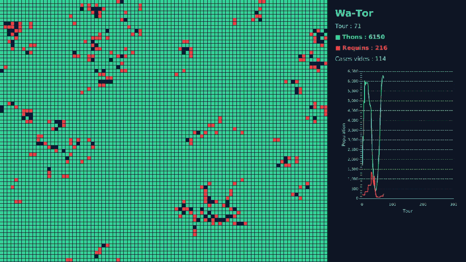

# Projet : Wa-Tor

Wa-Tor est une planète entièrement recouverte d'eau, peuplée de thons et de requins.
Les thons se déplacent et se reproduisent. Les requins mangent les thons, se reproduisent
aussi, et meurent de faim s'ils ne trouvent rien à manger. Aucune règle ne dit « les
populations doivent osciller », et pourtant c'est ce qui se produit : trop de requins font
disparaître les thons, puis les requins meurent de faim, puis les thons reviennent.

La vidéo complète est disponible ici : [demo.mp4](assets/wator/demo.mp4).
Elle fait référence : votre application doit se comporter de la même façon.

**Barème :** ce projet compte pour **6 points sur 20**.

## Objectifs

Ce projet est un projet de **Java**, pas de JavaFX. À la fin, vous aurez pratiqué :

- la conception de plusieurs classes qui collaborent ;
- l'héritage et le polymorphisme ;
- l'encapsulation ;
- les collections et les streams ;
- la séparation entre le **modèle** (la logique) et la **vue** (l'affichage).

Vous partez de zéro. Le sujet décrit ce que l'application doit faire et les règles à
respecter. Il ne donne ni la liste des classes ni les étapes à suivre : la conception et
l'organisation du travail vous reviennent.

## Ce que fait l'application

### La mer

- L'application s'ouvre en plein écran : la mer à gauche, un panneau de statistiques à droite.
- La mer est une grille de cases carrées de 10 pixels de côté, qui occupe toute la place
  laissée par le panneau.
- Chaque case est vide, ou contient un thon, ou contient un requin. Jamais deux animaux
  dans la même case.
- Une case a quatre voisines : en haut, en bas, à gauche, à droite.
- La mer n'a pas de bord. La case à droite de la dernière colonne est la première colonne
  de la même ligne, et de même en haut et en bas.
- Une case vide est bleu foncé, un thon est vert, un requin est rouge.

### Le temps

- Le temps avance par tours. À chaque tour, chaque animal agit exactement une fois.
- L'ordre dans lequel les animaux agissent est tiré au hasard à chaque tour.
- L'application joue 10 tours par seconde.
- La touche Espace met en pause et relance. La touche Échap quitte l'application.

### Le panneau de statistiques

- Il affiche le numéro du tour, le nombre de thons, le nombre de requins et le nombre de
  cases vides. Ces nombres sont mis à jour à chaque tour.
- Il affiche un graphique de l'évolution des deux populations sur les 300 derniers tours :
  une courbe pour les thons, une courbe pour les requins, dans les mêmes couleurs que sur la mer.

### Au démarrage

- 30 % des cases contiennent un thon et 3 % contiennent un requin, placés au hasard.

### Un thon, à chaque tour

- Il se déplace vers une case voisine vide, choisie au hasard. Si aucune n'est vide, il
  reste sur place.
- Il se reproduit tous les 3 tours : s'il a survécu 3 tours depuis sa naissance ou sa
  dernière reproduction, et s'il vient de se déplacer, il laisse un nouveau thon dans la
  case qu'il quitte.

### Un requin, à chaque tour

- S'il y a au moins un thon dans une case voisine, il se déplace sur l'un d'eux, choisi au
  hasard, et le mange.
- Sinon, il se déplace vers une case voisine vide, choisie au hasard. Si aucune n'est vide,
  il reste sur place.
- S'il n'a rien mangé depuis 3 tours, il meurt et sa case devient vide.
- Il se reproduit tous les 10 tours, de la même façon qu'un thon : s'il vient de se
  déplacer, il laisse un nouveau requin dans la case qu'il quitte.

## Règles à respecter

Ces règles font partie du sujet. Elles seront vérifiées.

1. **Deux paquetages : `model` et `view`.** Tout ce qui décide quelque chose (déplacements,
   reproduction, chasse, famine, comptages) est dans `model`. Tout ce qui affiche est dans `view`.
2. **Aucun `import javafx` dans le paquetage `model`.** Le modèle doit pouvoir fonctionner
   sans fenêtre.
3. **Un animal n'est pas une forme JavaFX.** Les classes qui représentent les animaux
   n'héritent d'aucune classe JavaFX, n'en contiennent aucune et ne savent pas se dessiner.
   C'est la vue qui connaît le modèle, jamais l'inverse.
4. **Le modèle ne connaît pas la vue.** Aucune classe de `model` n'utilise une classe de `view`.
5. **Tous les attributs sont privés.** Aucun attribut `public`, aucune variable `static` modifiable.
6. **Pas de `instanceof`, et pas de `switch` ni de `if` sur le type d'un animal.** La mer ne
   demande jamais à un animal « es-tu un thon ou un requin ? ».
7. **Les nombres du sujet ne sont écrits qu'une fois.** Les durées de reproduction, la durée
   de famine et les proportions de départ sont des constantes nommées.
8. **La partie JavaFX reste petite** : environ 250 lignes au total dans `view`. Si elle
   grossit, c'est que de la logique s'est glissée dans la vue.

## Critères de validation

Votre travail est correct si :

- l'application se comporte comme décrit plus haut ;
- aucune case ne contient jamais deux animaux, et aucun animal n'agit deux fois dans le même tour ;
- un animal qui sort par un bord réapparaît du côté opposé ;
- sans aucun requin au départ, les thons finissent par remplir toute la mer ;
- sans aucun thon au départ, tous les requins ont disparu après 3 tours ;
- avec les valeurs du sujet, les deux populations montent et descendent tour à tour : on le
  voit sur le graphique, et l'on voit sur la mer des fronts de requins avancer dans les bancs de thons ;
- à tout moment, thons + requins + cases vides = nombre total de cases ;
- toutes les règles ci-dessus sont respectées.

## Ce que vous rendez

- Le projet Maven complet, qui se lance avec `mvn javafx:run`.
- Un court fichier `README.md` qui liste vos classes, avec une phrase par classe pour
  expliquer son rôle, et qui justifie vos choix de conception.

## Pour aller plus loin

Ces extensions sont facultatives.

- **Le portrait de phase.** Ajoutez un second graphique avec le nombre de thons en abscisse
  et le nombre de requins en ordonnée. La simulation y dessine une boucle.
- **Une troisième espèce.** Par exemple une algue qui pousse dans les cases vides et que
  seuls les thons mangent, ou une orque qui mange les requins. Si votre conception est
  bonne, vous ajoutez une classe et vous ne modifiez presque rien d'autre.
- **Des paramètres réglables.** Changez les durées de reproduction et de famine au clavier
  pendant la simulation, et observez l'effet sur l'équilibre.
